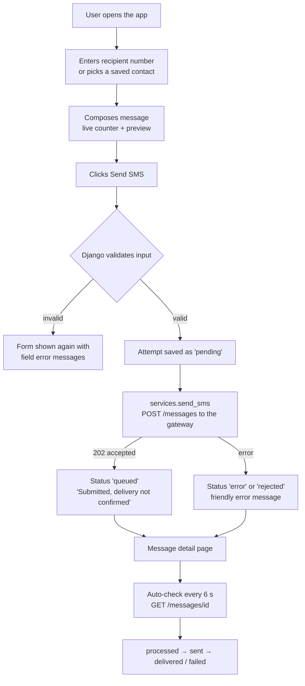

# TextBridge – Django SMS Sender

**IT 120 – Integrative Programming and Technologies · Group Assignment: Build a Django Application for Sending SMS**

TextBridge is a Django web application that lets a user compose a text message, validates the recipient and message, submits it through an **SMS gateway API**, and reports what the gateway said. Every attempt is saved to a history dashboard where the delivery status is tracked until the message is delivered or fails.

The SMS provider is **[SMS Gateway for Android](https://sms-gate.app)**, an open-source Android app that turns a phone into an SMS gateway with a REST API. Messages are sent from that phone's own SIM card, so they reach any Philippine mobile number with no sender registration or recipient verification.

## 1. Application objectives

| | |
|---|---|
| **Purpose** | Provide a simple, safe web interface for sending SMS messages through an external SMS gateway API and for seeing whether each message was submitted, delivered, or failed. |
| **Users** | Small offices, school organizations, or teachers who need to send short notices (reminders, announcements, alerts) to a few authorized phone numbers from a browser. |
| **SMS functionality** | Enter a phone number (or pick a saved contact) and a message → the app validates both → submits the message to the gateway's REST API → shows a success or error message → records the attempt → automatically tracks the delivery status. |

The app **distinguishes submission from delivery**. A successful API call only means the gateway *accepted* the message, so the app reports "Submitted – delivery is not confirmed yet". It shows **Delivered** only after the recipient's phone sends back a delivery report.

## 2. Group members and responsibilities

| Member | Role | Responsibilities |
|---|---|---|
| **Romeo C. Gucela** | Backend developer | Django project setup, settings and environment configuration, models, views, URL routing, application logic |
| **Prince Johnard Gonzales** | Frontend & validation | Templates, CSS/JavaScript, compose form, input validation, character counter, preview, user feedback messages |
| **Sean Charnel R. Morales** | Integration & QA | SMS gateway integration (`services.py`), status tracking, automated tests, README, demonstration video |

All members reviewed the complete code and can explain the full workflow.

## 3. Main features

**Core**
- SMS compose form with a recipient phone number, a message box and a **Send SMS** button (CSRF-protected).
- Server-side validation of phone numbers (using Google's `phonenumbers` library) and messages, with clear error messages under each field.
- Local numbers such as `0917 123 4567` are automatically converted to international E.164 format (`+639171234567`).
- Friendly handling of every common failure: missing credentials, wrong username or password, network errors, timeouts, gateway phone offline, gateway outages, and rejected or failed messages.
- Success and error feedback on every send. The result page uses Post/Redirect/Get, so refreshing never sends the message twice.

**Additional features**
1. **Message history dashboard**: every attempt, including failed ones, with totals for *Delivered*, *Submitted (not confirmed)* and *Failed/Rejected*, filter cards you can click, text search and pagination.
2. **Message status tracking**: a page for each message with a progress tracker (sent to gateway → accepted → sent by phone to carrier → delivery confirmed). It **checks the gateway automatically every few seconds** and updates itself when the status changes. There is also a manual **Refresh delivery status** button.
3. **Contact management**: save, list and delete authorized test recipients, and send to a contact with one click.
4. **Character counter & segment calculator**: a live count that detects GSM-7 vs Unicode (emoji) encoding and shows how many SMS segments the message will use.
5. **Live message preview**: a phone-style bubble showing exactly what will be sent and to whom.
6. **Provider status indicator**: the top bar shows whether the gateway is configured, without revealing any credential.

## 4. Technologies and dependencies

| Technology | Use |
|---|---|
| Python 3.11+ | Programming language |
| Django 5.2 | Web framework (MVT, forms, ORM, CSRF, messages, admin) |
| SMS Gateway for Android | SMS provider: an Android app with a REST API (cloud or local Wi-Fi mode) |
| requests | HTTP client used to call the gateway's REST API |
| phonenumbers | Phone-number parsing and validation |
| python-dotenv | Loads secrets from a local `.env` file |
| SQLite | Stores message history and contacts |
| HTML, CSS, vanilla JavaScript | User interface with no external CDN, so it works offline; supports light and dark mode |

Exact versions are pinned in [`requirements.txt`](requirements.txt).

## 5. SMS workflow



1. **Recipient**: a typed number or a saved contact, validated and normalized to E.164.
2. **Message**: 1 to 1,600 characters and not blank.
3. **Sending process**: the view stores the attempt, then `sms_app/services.py` sends `POST {SMSGATE_URL}/messages` with HTTP Basic Auth and a 15-second timeout. The gateway forwards the message to the Android phone, which sends it through its SIM.
4. **Feedback**: a success or error banner, plus a detail page that shows the gateway status, explains it, and updates automatically.

### Request sent to the gateway

```json
POST https://api.sms-gate.app/3rdparty/v1/messages
{
  "textMessage": { "text": "Hello from IT 120!" },
  "phoneNumbers": ["+639171234567"],
  "withDeliveryReport": true
}
```

### Status meanings

| App status | Gateway state | Meaning | Shown as |
|---|---|---|---|
| `error` | – | Never reached the gateway (missing or wrong credentials, network problem, phone offline) | Failed |
| `rejected` | – | The gateway refused the request (HTTP 400/409) | Failed |
| `queued` | Pending | Stored by the gateway, waiting for the phone | Submitted (not confirmed) |
| `processed` | Processed | The phone handed the message to Android's SMS system | Submitted (not confirmed) |
| `sent` | Sent | The mobile carrier accepted the message | Submitted (not confirmed) |
| `delivered` | Delivered | The recipient's phone confirmed receipt | Delivered |
| `failed` / `canceled` | Failed / Cancelled | Could not be sent (no load, no signal, invalid number…) | Failed |

## 6. Project structure

```
IT120/                         ← repository root
├── .env.example               ← safe template for secrets (copy to .env)
├── .gitignore                 ← excludes .env, venv, db.sqlite3, caches
├── requirements.txt
├── README.md
└── sms_project/               ← Django project (contains manage.py)
    ├── manage.py
    ├── sms_project/           ← project configuration
    │   ├── settings.py        ← reads all secrets from environment variables
    │   └── urls.py
    ├── sms_app/               ← the SMS application
    │   ├── models.py          ← Contact, SmsMessage (+ status logic)
    │   ├── forms.py           ← SmsForm, ContactForm, phone validation
    │   ├── services.py        ← SMS gateway integration + error translation
    │   ├── views.py           ← compose, history, detail, refresh status, contacts
    │   ├── urls.py
    │   ├── admin.py
    │   ├── context_processors.py
    │   ├── tests.py           ← 42 automated tests
    │   ├── migrations/
    │   └── templates/sms_app/ ← compose, history, message_detail, contacts
    ├── templates/base.html    ← shared layout
    └── static/                ← css/style.css, js/compose.js, js/status_poll.js
```

## 7. Installation and setup

Requirements: Python 3.11 or newer, Git, and an Android phone (Android 5.0+) with a SIM card that has load or an unli-text promo.

```bash
# 1. Clone the repository
git clone <your-repository-url>
cd IT120

# 2. Create and activate a virtual environment
python -m venv venv
venv\Scripts\activate          # Windows
# source venv/bin/activate     # macOS / Linux

# 3. Install dependencies
pip install -r requirements.txt

# 4. Create your local configuration file
copy .env.example .env         # Windows
# cp .env.example .env         # macOS / Linux
#   → open .env and fill in the values (see section 8)

# 5. Create the database tables
cd sms_project
python manage.py migrate
```

Generate a Django secret key for `.env` with:

```bash
python -c "from django.core.management.utils import get_random_secret_key; print(get_random_secret_key())"
```

## 8. Configuring the SMS gateway

1. On the Android phone, install **SMS Gateway for Android** from Google Play, or download the APK from <https://sms-gate.app>.
2. Open the app and allow the **SMS** permission. Allow **notifications** too, and turn off battery optimization for the app so Android doesn't stop it.
3. Choose a mode:

   **Cloud mode (recommended)**: works even if the computer and phone are on different networks.
   - Turn on **Cloud server**, then tap **Online/Offline** to start the service and confirm the **Sign Up** dialog.
   - The app generates a **username** and **password**, shown under **Cloud Server**.
   - Set `SMSGATE_URL=https://api.sms-gate.app/3rdparty/v1`.

   **Local mode**: no internet needed on the phone, but the computer and phone must be on the **same Wi-Fi**.
   - Turn on **Local server** and start the service.
   - The app shows the phone's local IP address, port `8080`, a username and a password.
   - Set `SMSGATE_URL=http://<phone-ip>:8080`, for example `http://192.168.1.50:8080`.

4. Put the values in `.env`, never in source code:

| Variable | Required | Example / notes |
|---|---|---|
| `DJANGO_SECRET_KEY` | yes when `DJANGO_DEBUG=False` | long random string |
| `DJANGO_DEBUG` | no | `True` for local development |
| `DJANGO_ALLOWED_HOSTS` | no | `127.0.0.1,localhost` |
| `SMSGATE_URL` | yes | cloud `https://api.sms-gate.app/3rdparty/v1` or local `http://<phone-ip>:8080` |
| `SMSGATE_USERNAME` | yes | shown in the app |
| `SMSGATE_PASSWORD` | yes | shown in the app; keep it secret |
| `SMSGATE_SIM_NUMBER` | no | `1`, `2` or `3` on dual-SIM phones; empty = default SIM |
| `SMSGATE_TIMEOUT` | no | `15` seconds |
| `SMS_DEFAULT_REGION` | no | `PH`, used to read local numbers like `0917…` |
| `TIME_ZONE` | no | `Asia/Manila` |

5. Restart the Django server. The top bar shows **SMS gateway configured** once the variables are loaded.

**Cost:** the gateway app and its cloud server are free. Each SMS is charged like a normal text from the phone's SIM, so an unli-text promo keeps testing cheap.

## 9. Running the application

```bash
cd sms_project
python manage.py runserver
```

Open <http://127.0.0.1:8000/>. Keep the gateway phone on, unlocked or charging, and with the app running.

| Page | URL |
|---|---|
| Compose / send SMS | `/` |
| History dashboard | `/history/` |
| Message detail & status | `/messages/<id>/` |
| Contacts | `/contacts/` |
| Django admin (optional, run `python manage.py createsuperuser` first) | `/admin/` |

## 10. Testing

### 10.1 Automated tests

The test suite replaces the HTTP calls to the gateway with mocks. It runs without credentials, without a phone, without internet access and without spending load.

```bash
cd sms_project
python manage.py test sms_app -v 2
```

Result: **42 tests, all passing** (Django 5.2.19, Python 3.11.4).

| Assignment test case (Step 6) | Automated test(s) | Expected result | Result |
|---|---|---|---|
| Valid phone number and message | `test_valid_input_submits_to_gateway` | Correct JSON request with Basic Auth sent to `/messages`; saved as `queued` | ✅ Pass |
| Empty phone number | `test_empty_phone_number_is_rejected` | Rejected with “Please enter the recipient's phone number.”; gateway not called | ✅ Pass |
| Empty message | `test_empty_message_is_rejected`, `test_whitespace_only_message_is_rejected` | Rejected with “Please type a message before sending.” | ✅ Pass |
| Invalid phone number | `test_invalid_phone_numbers_are_rejected`, `test_landline_is_rejected`, `test_gateway_rejects_request`, `test_immediately_failed_message` | Validation error, or a friendly message if the gateway rejects it | ✅ Pass |
| Incorrect or missing credentials | `test_missing_credentials`, `test_incorrect_credentials_do_not_leak_secrets`, `test_gateway_error_text_containing_secret_is_hidden` | Clear message; username and password never appear in the page or database | ✅ Pass |
| Provider or network error | `test_network_error`, `test_timeout`, `test_phone_offline_or_queue_full`, `test_gateway_server_error`, `test_unexpected_exception_is_handled` | Understandable failure message, no crash | ✅ Pass |
| Successful provider response | `test_success_does_not_claim_delivery` | Says “submitted… Delivery is not confirmed yet”, never “Delivered” | ✅ Pass |
| CSRF protection | `test_post_without_csrf_token_is_rejected`, `test_auto_refresh_requires_csrf_token` | HTTP 403; nothing sent | ✅ Pass |
| Status tracking | `test_refresh_updates_to_delivered`, `test_all_gateway_states_are_mapped`, `test_refresh_records_failure_reason`, `test_failed_refresh_keeps_previous_status`, `test_auto_refresh_json_endpoint`, … | Every gateway state mapped correctly; failed lookups don't corrupt data | ✅ Pass |
| History, search, contacts | `HistoryAndContactsTests` (7 tests) | Correct totals and filters; contacts normalized, duplicates rejected, history kept when a contact is deleted | ✅ Pass |

We also called the **real** gateway API at `api.sms-gate.app` with a deliberately fake username and password. The gateway answered HTTP 401, and the app displayed “The SMS gateway rejected the username or password…” without showing either value. A local-mode address that could not be reached produced the friendly timeout message.

### 10.2 Manual tests with the real gateway phone

| # | Test | Steps | Expected result | Actual result |
|---|---|---|---|---|
| 1 | Send to a group member | Enter the number and a message, then Send | Success banner “submitted… not confirmed”, status *Queued on gateway* | _fill in_ |
| 2 | Delivery confirmation | Stay on the message page for about 10–30 s | Status changes by itself to *Sent to carrier* and then *Delivered*; the SMS arrives on the phone | _fill in_ |
| 3 | Empty phone number | Leave the number blank, then Send | Field error; nothing sent | _fill in_ |
| 4 | Empty message | Leave the message blank, then Send | Field error; nothing sent | _fill in_ |
| 5 | Invalid number | Enter `12345`, then Send | “This phone number is not valid…” | _fill in_ |
| 6 | Wrong password | Change `SMSGATE_PASSWORD` in `.env`, restart, then Send | Credentials error; password not shown | _fill in_ |
| 7 | Gateway phone offline | Turn on airplane mode on the gateway phone (local mode), then Send | “Could not connect…” or timeout message | _fill in_ |
| 8 | Character counter | Type 161 characters, then add an emoji | 2 segments; switches to Unicode | _fill in_ |
| 9 | Contacts | Add a contact as `0917…`, then send from the Contacts page | Saved as `+63917…`; number pre-filled | _fill in_ |

## 11. Security measures

- **No secrets in code or Git.** All credentials come from environment variables or `.env`. `.env` is listed in `.gitignore`, and only `.env.example` with placeholders is committed.
- **Secrets never displayed.** Error messages are translated into friendly text. Any gateway error text that contains the username or password is suppressed, and the server log records only HTTP status codes.
- **CSRF protection** on every form (`` + `CsrfViewMiddleware`), including the automatic status checks, which send the CSRF token in a header.
- **State-changing actions use POST only**: send, refresh status and delete contact.
- **Django's auto-escaping** prevents message text from injecting HTML or JavaScript into the history pages.
- **Hardened defaults:** `DEBUG` is off unless explicitly enabled; `X-Frame-Options: DENY`, `nosniff`, HTTP-only cookies and secure cookies in production; the app refuses to start without a secret key in production.
- **HTTPS in cloud mode:** credentials and messages travel to `api.sms-gate.app` over HTTPS.
- **Responsible use:** only group members and people who agreed to receive test messages are used as recipients.

## 12. Known limitations

- **Depends on a phone.** The gateway phone must be on, connected, and running the app. If it is off, messages wait in the cloud queue or fail.
- **Local mode is unencrypted.** It uses plain HTTP on the Wi-Fi network, so use it only on a trusted network. Cloud mode uses HTTPS.
- **Normal SMS charges apply** to the phone's SIM, and carriers may limit how many texts a SIM can send per day.
- **Delivery reports depend on the carrier.** Some networks never send delivery reports, so a message can stay at *Sent to carrier* even though it arrived. Automatic checking stops after about two minutes; the **Refresh delivery status** button still works after that.
- **No user login.** Anyone who can open the app can send messages, so it is intended to run locally (`127.0.0.1`) for demonstration. A public deployment would need Django authentication and rate limiting.
- **Sending is synchronous.** The page waits for the gateway (15-second timeout). Bulk sending would need a task queue such as Celery.
- **One recipient per message.** Bulk or group sending is intentionally not supported.
- **SQLite** is suitable for a class project, not for many concurrent users.

## 13. Demonstration video

[Insert video link here]
